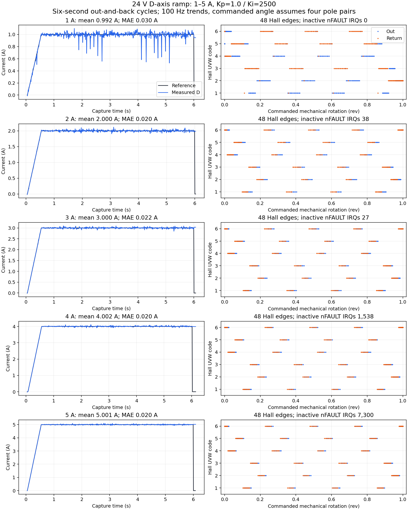

# 24 V current ramp and nFAULT shutdown diagnosis

Status: **DONE_WITH_CONCERNS**. All five bounded 1–5 A tests completed. The
user reported normal shaft motion and confirmed EVM power OFF. The drive was
disarmed with ENABLE, INLs and PWM MOE confirmed LOW. No further run is active.

## Debug report

| Item | Result |
|---|---|
| Symptom | Earlier Hall-observation motion builds stopped on nFAULT near 0.082 commanded revolutions, at both 2 A and 3 A supply-input limits. |
| Software root cause | The EXTI handler stopped on a pending falling edge even when PB1/nFAULT had already returned HIGH before IRQ entry. |
| Evidence before fix | Refined 2 A capture: IRQ-entry GPIOB `0x11b`, pre-SPI GPIOB `0x15b`, both PB1 HIGH. First R0 read `1`, repeated R0 `0`, R1 `0`, R2 `0x20`. The first-read phase-C interpretation was unreliable. |
| Fix | Motion-only handler acknowledges and counts already-inactive edges. Active-LOW IRQ shutdown, independent SysTick LOW check, USER, ADC/current and timing guards remain. Boot software IRQ test is preserved with outputs disabled. |
| Source | `src/repo_motor_main.c:128` IRQ; `:70` disabled-phase bounded fault capture; `:414` boot-only test flag. Driver reader is in `src/drv8353.c`. |
| Regression | `tools/tuning/test_fault_irq_arm.py`: actual compiled Thumb IRQ fails the inactive-edge case on the previous image and passes all four cases on the fix. |
| Related | Hall GPIO audit found no PB1 configuration/routing changes. PB6/7/8 internal pulls are ON; PB1 internal pull remains OFF, with the existing EVM external pull-up. User measured powered idle nFAULT at 3.3 V. |
| Remaining concern | The electrical source of short inactive nFAULT events remains unidentified. Counts rose sharply at 4/5 A. No claim that every resolved transient is harmless. |

## Hardware verification

Fixed 24 V, 3 A supply-input limit; assembled, secured unloaded motor; Hall
sensors connected. Firmware interface `0x1000B`, saved Kp=1.0/Ki=2500. Each
test used a fresh physical USER arm, one-second alignment and two 2.5-second
cosine legs, one commanded mechanical revolution each way. Settings were
applied while disarmed. No driver protection mode or threshold was relaxed.

| Current A | Mean A | MAE A | Voltage peak V | Saturation samples | Inactive IRQs |
|---:|---:|---:|---:|---:|---:|
| 1 | 0.9920 | 0.0301 | 0.9728 | 26 | 0 |
| 2 | 1.9999 | 0.0199 | 1.4582 | 0 | 38 |
| 3 | 3.0004 | 0.0215 | 1.9411 | 0 | 27 |
| 4 | 4.0019 | 0.0197 | 2.5077 | 0 | 1538 |
| 5 | 5.0010 | 0.0202 | 3.0806 | 0 | 7300 |

All runs ended state0/reason9/result0, two half moves, 48 qualified Hall changes
and all six valid codes. Cumulative transitions240, invalid0, multibit0.
No active fault captures, CPU CFSR/HFSR or Recorder faults. The maximum
observed control IRQ was34.25 us against a45 us guard (cumulative since boot).
The boot software-fault check accounts for the initial fault-IRQ counter of1;
it is not a powered fault. End-of-run zero fault-snapshot globals mean no
capture occurred on the fixed image; they are not continuously read driver status.

Mean/MAE use unweighted 100 Hz trend samples at common reference/measured
timestamps once the reference reaches99.9% of its target (546 samples/run).
Voltage peak and saturation counts use the full captured trend. These are
sampled statistics, not raw20 kHz extrema. At1 A the1 V ceiling causes some
saturation/current dips; it still completed normally. Pre-arm measured bus
was23.711–23.809 V; no high-speed bus waveform was acquired.

## Hall plots and evidence

MCUViewer is STOP on `Hall and rotation capture`, retaining the5 A data.
It contains Hall/time, commanded-rotation/time and Hall/commanded-rotation XY
plots; original controls and Recorder groups remain available. The project is
`tools/tuning/current-loop-free-hall-24v.mcuv`. A project stores configuration;
the archived JSON/ZIP files preserve the curves. Acquisition restart may replace
the in-memory capture.

X is commanded rotation assuming four pole pairs, not independent shaft angle.
The20 kHz observer provides transition counts; the100 Hz XY display is a trend,
not an accurate edge-angle calibration. Hall feedback is not yet controlling
the motor. Each out/back shows valid Hall sequencing in both directions.



- Machine-readable summary: [results](2026-11-11-current-ramp-fault-fix.json).
- Earlier failures and diagnosis: [diagnosis](2026-11-11-current-ramp-diagnosis.json).
- Raw captures/preflight/postflight checks and analysis script:
  [raw ZIP](current-tuning/current-ramp-fixed-24v-20261111.zip).
- Selected trends: `current-tuning/current-ramp-fixed-{1..5}a-20261111-trend.json`.
- Exact local firmware, symbols, full readbacks, portable viewer project and
  SHA256 manifest: `outputs/checkpoints/current-ramp-fault-fix-24v-2026-11-11`.

Flashed HEX SHA256:
`de46fa8006200989e5a10d60efede30ef7378f56afbf0bcfca301d3d4b9fe322`.
ELF SHA256:
`7ef8f9c9f2c5aaec2fe78d3d08d412f69fead4b8270cfc3392d50ebc3c55d52f`.
Flash/verify touched sectors0/1 only after fresh EVM-OFF confirmation; the
sector7 gain journal was preserved. COM3 was untouched.

Reproduce statistics/plot without hardware (matplotlib required):

```sh
python -m zipfile -e docs/bench/current-tuning/current-ramp-fixed-24v-20261111.zip outputs/tuning/current-ramp-fixed
python outputs/tuning/current-ramp-fixed/analyze_results.py
```

## Software validation, separate from bench results

Current image passed the full ARM build, upstream23 tests/42 checks, and
current-tuning12 V/24 V stationary/24 V motion PI, vendor Recorder/mailbox/NV
ASan/UBSan suites. New low-current bounds, RL tracking, bounded completion,
arming gates, Hall sequences/glitch rejection and GPIO preservation pass.
Existing vendor Recorder signedness warning remains.

Compiled-code emulation results:

```text
IRQ: PASS inactive_edge, active_low, boot_test, no_pending
Previous image: FAIL inactive_edge (calls stop_drive(2))
SPI snapshot: PASS success, phase_enabled, pwm_enabled, enable_low,
  spi_disabled, counter_disabled, busy_initially,
  tx_timeout, rx_timeout, busy_timeout
Hall audit: PASS startup comparison for five GPIO seeds,
  all eight Hall codes with PB1 toggling, no observer peripheral writes
```

The tools are `test_fault_irq_arm.py`, `test_fault_snapshot_arm.py` and
`test_hall_gpio_arm.py` under `tools/tuning`; they require Unicorn. Emulation
proves the exercised software paths, not electrical behavior or real SPI timing.
Fault capture removes INLs and MOE before reading status, with a shared
30000-cycle budget before ENABLE is lowered. The refined pre-fix actual capture
took237.03 us with phases disabled. No active capture occurred during the fixed ramp.

The next unresolved diagnostic is an electrical capture of nFAULT/PB1, ground
and bus, especially at higher current. Keep active-LOW protection intact.
No continuous-mode validation of this new Hall/fault image was performed.
