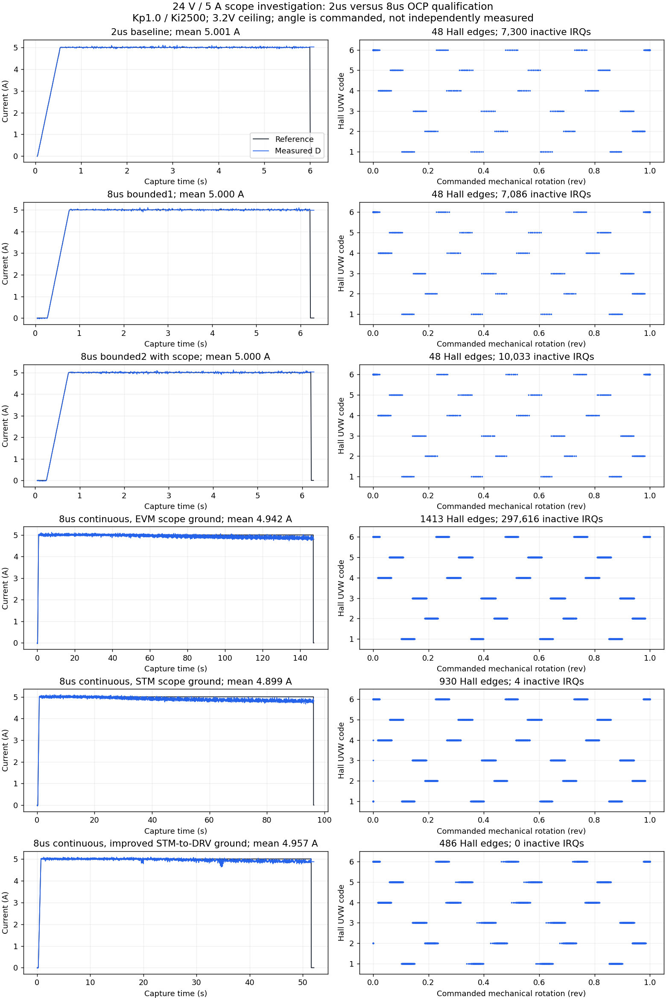

# 8 us OCP qualification and nFAULT scope comparison

**Motion tests completed; electrical cause remains unresolved.** The two
bounded 5 A cycles completed both legs. Three subsequent continuous captures
ended with physical USER stops, disabled outputs and user-confirmed EVM OFF.

## Results

| Test | Duration, approximately | Inactive nFAULT interrupts | Hall transitions | Stop |
|---|---:|---:|---:|---|
| Previous 2 us, 5 A | 6 s | 7,300 | 48 | Bounded completion |
| 8 us, first bounded 5 A | 6 s | 7,086 | 48 | Bounded completion |
| 8 us, bounded scope repeat | 6 s | 10,033 | 48 | Bounded completion |
| 8 us, continuous, scope ground on EVM bar | 147 s | 297,616 | 1,413 | USER |
| 8 us, continuous, scope ground on STM32 | 96 s | 4 | 930 | USER |
| 8 us, improved STM32-to-DRV ground | 52 s | **0** | 486 | USER |

Counters are **interrupts that found PB1 already HIGH**, not verified DRV fault
assertions or independent measurements of pulse count/width. Each row is the
post-run minus pre-run counter, excluding earlier runs and intervening power
cycles. None of these new runs captured an active-LOW fault. Hall invalid and
multi-bit counters stayed zero. Continuous half-move counts were58,38 and20.
CPU CFSR/HFSR and Recorder fault stayed zero; maximum recorded control IRQ34.5 us.

Increasing internal overcurrent qualification from2 to8 us did not eliminate
the events. The counts in the three bounded trials do not establish a useful
reduction; this is not a controlled statistical comparison.

Moving the scope ground coincided with a much larger change: about2,000
interrupts/second became almost none, despite visible glitches remaining.
This strongly suggests sensitivity to ground/return paths or probe loading.
The scope connection changes the circuit as well as its measurement reference;
this does not prove the installation is fixed with the probe removed.
Motor warming/current tracking also differed between the long runs, so the
grounding change is strong evidence to investigate, not a complete causal proof.

The user then improved the permanent ground connection between STM32 and DRV
and requested a repeat. The same E image and5 A continuous settings ran about
51.84 s with **zero total nFAULT interrupts**, not merely zero rejected events.
It recorded486 valid Hall changes and20 half moves before USER stop. The user
reported a similar scope waveform and confirmed EVM OFF afterward. This
supports the improved grounding setup and demonstrates that similar-looking
ripple is not a reliable proxy for fault-interrupt activity. Probe attachment
was not separately reconfirmed; a probe-free test remains useful before
claiming the installation is permanently quiet in every configuration.

## Firmware and preflight

`REPO_MOTION_24V` now selects R5=`0x139`, OCP_DEG=8 us. Previous`0x119` selects
2 us; its stale4 us source comment was corrected. Latched OCP mode,100 ns
dead time and0.6 V VDS threshold stay the same. Other firmware profiles retain
`0x119`. These are internal OCP detector settings, not nFAULT-wire filtering.
See [TI Table17](https://www.ti.com/lit/ds/symlink/drv8353.pdf).

The initial interface C preflight required the first two R5 reads to match and
stopped with reason7 before drive, zero control ticks. Revised D/E code records
the first frame and requires two subsequent matching reads. Actual arming
readbacks on all successful attempts were **`0x138`, `0x139`, `0x139`**,
confirming the first-frame low-bit artifact. Globals expose all three values:
`g_repo_ocp_first`, `g_repo_ocp_verify_first`, `g_repo_ocp_control`.
Diagnostics clear at the start of each arming attempt.

Final interface **0x1000E** additionally permits duration0 at exactly5 A for the
user-requested continuous scope capture. It reuses the existing reciprocal
trajectory: initial alignment, then repeated2.5 s legs. The3.2 V vector ceiling,
6.5/7 A filtered/raw guards, saved Kp1.0/Ki2500 gate, disarmed apply, fresh start,
physical USER arming, ADC checks, active-LOW fault shutdown and45 us timing guard
remain. Current1..4 A remains bounded only. The previous6 A profile is unchanged.
Viewer disconnect is not a stop; hold USER to stop continuous mode.

The first two continuous measured means were approximately4.94 and4.90 A;
their final ten-second means were4.85 and4.81 A. The3.2 V ceiling became active during the long runs,
so these were5 A commands with some current tracking shortfall. No voltage
ceiling increase was made. Saturation counts and exported statistics are in
the JSON; long exports are capped/decimated to10,000 points per signal, with
independent time grids. Reference and command angle are interpolated for analysis.
These are trend statistics, not raw20 kHz extrema or calibrated Hall edge angles.

## Scope observations

The user supplied two photos in chat; photos were not available as local files.
The first was100 us/div, Vpp current420 mV/max530 mV. The user reported200 mV/div
and scope ground on an EVM ground bar, then moved ground to the STM32.
The second photo shows20 us/div,200 mV/div, Vpp450 mV/max520 mV, trigger3.25 V,
and a current period50.20 us/frequency19.9 kHz. That timing is consistent with
the firmware's20 kHz PWM, suggesting switching-related interference; it does
not prove synchronization without a second-channel reference.

The boxed **B** beside CH1 indicates **20 MHz bandwidth limiting is enabled**.
Rigol documents that this attenuates high-frequency components. Turn
**CH1 -> BW Limit -> OFF** for a new capture of very fast glitches; this cannot
recover bandwidth already filtered from a saved acquisition.
[Rigol guide, section2-3](https://www.rigol.com/dam/global/downloads/brochures/en/user-manual/oscilloscopes/DS1000Z_UserGuide_EN.pdf).

Probe attenuation matching, DC coupling and exact absolute Vmin were not
confirmed. A0.5 V excursion from3.3 V would remain above the STM32's guaranteed
HIGH level2.31 V atVDD3.3 V, but bandwidth/probe/reference uncertainties prevent
using these photos to rule out shorter deeper excursions. A trigger at3.25 V
captures modest HIGH-level noise; it is not a logic-LOW qualification.
[STM32F411 Table53](https://www.st.com/resource/en/datasheet/stm32f411re.pdf).

Next useful measurements: full bandwidth, matched probe ratio/DC coupling,
short ground spring at the MCU and a zoomed glitch with absolute Vmin/width;
then compare EVM nFAULT and PB1 against their local logic grounds. Inspect the
permanent logic-ground/nFAULT return path. Do not classify every event as
harmless, or treat the scope-ground effect as a permanent wiring repair.

## Verification and evidence

Software: full ARM build; upstream23 tests/42 checks; PI, mailbox, actual vendor
Recorder, NV and profile contracts with ASan/UBSan PASS. Continuous5 A tests
exercise repeated motion beyond six seconds,3.2 V bounds and explicit stop.
Compiled IRQ four cases, bounded SPI reader ten cases and Hall GPIO/observer
audit PASS. Existing vendor Recorder signedness warning remains.

Each flash followed fresh physical EVM-OFF confirmation and touched sectors0/1
only. Sector7 gains were preserved. Boot checks and exact uploaded-flash/BIN
comparison passed. Final E HEX SHA256:
`f96b7e43aee2876464965038d0b22f1a562e359a67bb771011d12b5958b58b28`.
COM3 was untouched. Final disarmed state0/reason1, start3/apply2/host stop0
confirms physical USER shutdown rather than a host STOP command.

- [Machine-readable results](2026-11-11-ocp-deglitch-8us-24v-5a.json)
- [Current/Hall comparison plot](current-tuning/ocp-deglitch-8us-24v-5a-20261111.png)
- [Raw capture ZIP](current-tuning/ocp-deglitch-8us-24v-5a-20261111.zip)
- Exact local images, symbols, checks, scripts and SHA256 manifest:
  `outputs/checkpoints/ocp-deglitch-8us-24v-5a-2026-11-11`.
  C is at the root, D in `verified-readback`, final E in `continuous-5a`.

Status: **DONE_WITH_CONCERNS**. Requested motion/capture work completed; the
improved-ground run was interrupt-free, while grounding/probing dependence
and the visible ripple remain for diagnosis. This source and bench baseline is
preserved by tag `checkpoint/hall-24v-grounding-8us-2026-11-11` at the user's subsequent checkpoint request.

Reproduce the statistics and plot without hardware (matplotlib required):

```sh
python -m zipfile -e docs/bench/current-tuning/ocp-deglitch-8us-24v-5a-20261111.zip outputs/tuning/ocp8-reproduce
python outputs/tuning/ocp8-reproduce/analyze_scope_runs.py
```


